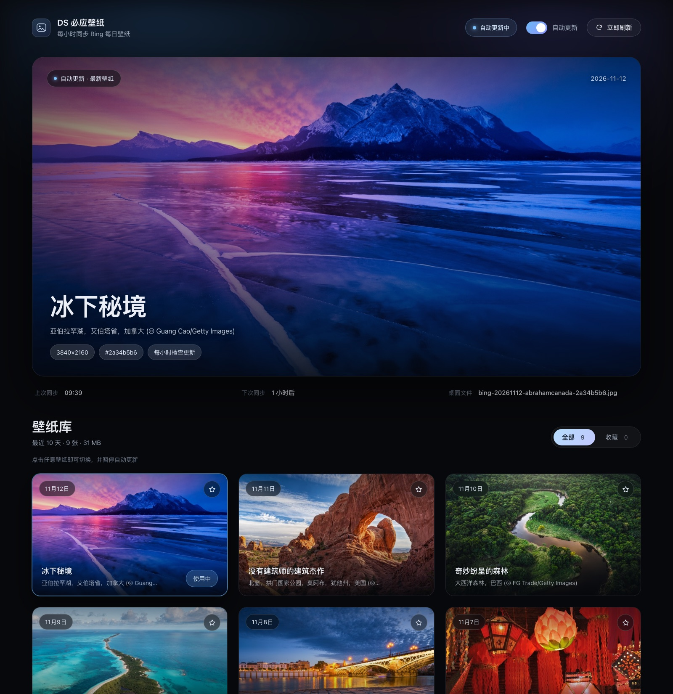

# DS 必应壁纸（DS Bing Wallpaper）

每小时从 Bing 抓取当日壁纸，自动设为 macOS 桌面背景；本地保留最近 10 天的壁纸，
提供 Web 面板浏览、切换和收藏。纯 Python 标准库 + 一个原生 Swift 小工具，
无第三方依赖、无网络上传。



---

## 它做什么

| 能力 | 说明 |
| --- | --- |
| 每小时同步 | 常驻进程内置定时器，启动时立刻抓一次，之后每 60 分钟一次 |
| 唤醒同步 | 睡眠唤醒后自动检测并立即同步（自动更新开启时直接切到当日最新），无需等满一小时 |
| 自动切换 | 开启「自动更新」时，切换到当日最新壁纸（同一张不会重复设置）；**关闭只代表不切换，图库照常抓取** |
| 手动固定 | 点击任意壁纸即切换，并**暂停**自动更新，固定使用你选的那张 |
| 恢复自动 | 打开「自动更新」会立即切换回最新壁纸 |
| 收藏 | 星标收藏，收藏的壁纸**永不**被 10 天清理删除 |
| 自动清理 | 超过 10 天且未收藏、非当前的壁纸，连同缩略图一起删除 |
| 多屏 | 通过 `NSWorkspace` 给所有显示器设置同一张壁纸 |
| 本地 Web 面板 | `http://127.0.0.1:8791`，只监听回环地址，需进程内令牌 |
| 打开文件夹 | 面板「打开文件夹」按钮直接在访达中定位壁纸库目录 |
| 延伸阅读 | 大图下方「了解这张壁纸 / 参加小测验」跳转 Bing，取自接口的 `copyrightlink` 与 `quiz` |

## 运行环境

仅支持 **macOS**，只依赖系统自带组件，不需要 pip / npm / brew，也不需要管理员权限。

| 项目 | 版本 / 要求 |
| --- | --- |
| 操作系统（开发与验证） | **macOS 27.2.1**（Build 26B131） |
| 处理器架构 | **Apple Silicon（arm64）**；Intel Mac 未验证 |
| 最低系统版本 | macOS 12 Monterey（App 声明 `LSMinimumSystemVersion = 12.0`，但仅在上述版本实测通过） |
| Python | 系统自带 **3.9.6**（`/usr/bin/python3`），只用标准库 |
| 编译工具 | Xcode Command Line Tools，**Swift 6.4.2**（`swiftc`） |
| 系统工具 | `sips`（sips-316）、`iconutil`、`launchctl`、`curl` |
| 磁盘占用 | App 约 2.5 MB，壁纸约 45 MB（10 天全量） |

> 服务只监听 `127.0.0.1`，壁纸与索引全部保存在本机，没有任何数据上传。

## 安装（其他用户）

```bash
# 1. 取得代码（或直接复制整个目录，放在哪里都可以）
git clone https://github.com/WalterBrightHub/ds-bing-wallpaper.git
cd ds-bing-wallpaper

# 2. 安装 Xcode 命令行工具：提供 swiftc / sips / iconutil（已装可跳过）
xcode-select --install

# 3. 一键安装：编译 wallpaperctl、生成图标、打包 App 并装入 /Applications
make install

# 4. 安装登录代理：开机自启 + 后台常驻 + 崩溃自动重启
make agent
```

安装完成后：

- 从「启动台」或「应用程序」打开 **DS 必应壁纸**，浏览器会打开面板；
- 也可以直接访问 <http://127.0.0.1:8791>；
- 首次启动会补齐最近 8 天壁纸（约 30 MB），并立即把桌面切成当天壁纸。

验证是否装好：

```bash
curl -fsS http://127.0.0.1:8791/api/health
# {"ok": true, "app": "DS Bing Wallpaper", "version": "1.3.1"}
```

几点说明：

- **不需要 sudo**：`/Applications` 不可写时会自动装到 `~/Applications`。
- **不要移动项目目录**：启动器在打包时把项目绝对路径写进了 App 内脚本，移动后
  重新执行 `make install && make agent` 即可。
- **没有 Xcode 命令行工具**也能跑，但 `wallpaperctl` 无法编译，设置壁纸会回退到
  AppleScript，需要到「系统设置 → 隐私与安全性 → 自动化」里授权。
- 通过 zip / 网盘 / AirDrop 拿到的 App 可能带隔离标记，首次打开请**右键 → 打开**，
  或执行 `xattr -dr com.apple.quarantine "/Applications/DS 必应壁纸.app"`。
- App 为本地 ad-hoc 签名、未做公证，属正常现象。

## 图片是怎么获取的（调查结论）

访问 `https://www.bing.com/?mkt=zh-CN` 会被 302 到 `cn.bing.com`。页面 HTML 里
**只有**一张低清预览图：

```
/th?id=OHR.NorthWindow_ZH-CN6734579353_tmb.jpg
```

真正的高清地址来自首页加载的 JSON 接口，这也是唯一稳定的来源：

```
https://www.bing.com/HPImageArchive.aspx?format=js&idx=0&n=8&mkt=zh-CN
```

返回的每条记录里 `urlbase` 形如 `/th?id=OHR.NorthWindow_ZH-CN6734579353`，在它后面
拼上分辨率后缀即可下载原图：

| 后缀 | 分辨率 | 体积 |
| --- | --- | --- |
| `_UHD.jpg&rf=LaDigue_UHD.jpg` | 3840×2160 | ≈3.7 MB |
| `_1920x1200.jpg&rf=LaDigue_1920x1200.jpg` | 1920×1200 | ≈1.0 MB |
| `_1920x1080.jpg&rf=LaDigue_1920x1080.jpg` | 1920×1080 | ≈0.3 MB |

本项目默认用 **UHD**。`n=8` 一次可拿最近 8 天，用于首次安装时补齐图库和补漏。

## 壁纸是怎么设置的（为什么不osascript）

`osascript` 操作 `System Events` 需要「自动化」授权，在后台进程里经常直接报
`-10004 权限违例`。本项目改用原生 API：

```swift
NSWorkspace.shared.setDesktopImageURL(url, for: screen, options: [:])
```

编译成 `bin/wallpaperctl`（约 60 KB），命令行 `wallpaperctl set <path>` / `get`。
无需任何系统授权弹窗。若机器没有 Xcode Command Line Tools，会回退到 AppleScript。

## 目录结构

```
ds-bing-wallpaper/
├── server/              # Python 标准库 HTTP 服务
│   ├── app.py           # 路由、令牌鉴权、静态资源
│   ├── bing.py          # 抓取、下载、命名、缩略图
│   ├── service.py       # 同步 / 切换 / 清理 业务逻辑
│   ├── scheduler.py     # 每小时定时器
│   ├── store.py         # index.json / state.json 原子读写
│   ├── wallpaper.py     # 调用 wallpaperctl
│   └── config.py        # 路径与常量
├── web/                 # 面板（原生 HTML/CSS/JS，无构建步骤）
├── src/wallpaperctl.swift
├── launcher/launcher.sh # .app 内的启动脚本
├── scripts/             # 构建 / 安装 / 卸载
├── tests/               # 单元测试
└── dist/DS 必应壁纸.app  # 启动器
```

## 数据与命名规范

数据目录：`~/Library/Application Support/DSBingWallpaper/`

```
DSBingWallpaper/
├── index.json                     # 壁纸元数据索引
├── state.json                     # 设置、当前壁纸、锁定的壁纸
├── app.log                        # 同步日志
└── wallpapers/
    ├── 2026-11/                   # 按月归档原图
    │   └── bing-20261111-northwindow-4cd78b6a.jpg
    ├── previews/                  # 1600px 面板大图
    │   └── bing-20261111-northwindow-4cd78b6a.jpg
    └── thumbs/                    # 640px 网格缩略图
        └── bing-20261111-northwindow-4cd78b6a.jpg
```

文件名规则：`bing-{日期}-{画面代号}-{哈希前8位}.jpg`

- **日期** `20261111`：Bing 的 `startdate`，就是这张壁纸的「所属日期」
- **画面代号**：从 `OHR.NorthWindow_...` 提取并小写，如 `northwindow`
- **哈希前 8 位**：Bing 的 `hsh`，同一画面改版时会变，避免覆盖

同一张图在 `2026-11/`、`previews/`、`thumbs/` 下**同名**，删除时三份一起删，
不会留下孤儿文件。

## 应用图标

图标取自 `assets/app-icon-source.png`（1254×1254 方图），构建时按 macOS 规范生成：
艺术区 824pt 居中于 1024pt 透明画布，圆角半径 22.45%。

```bash
make build      # 重新生成 AppIcon.icns 并打包
```

该源图属于个人素材，已在 `.gitignore` 中排除，不进版本库；若该文件不存在，
构建会自动退回内置的备用图标，因此克隆仓库仍然可以正常构建与运行。

## 使用

- **启动台 / 应用程序** 双击「DS 必应壁纸」→ 打开面板
- 面板地址：<http://127.0.0.1:8791>（端口被占用时自动顺延，实际地址写在
  `~/Library/Application Support/DSBingWallpaper/server-url`）
- 右上角开关「自动更新」只控制**是否把桌面切换到最新壁纸**；抓取、下载、清理与它无关，
  关闭后仍每小时自动补图库（面板状态会显示「切换已暂停」）
- 「立即刷新」立刻同步一次
- 大图下方的 **了解这张壁纸**（Bing 搜索拍摄地介绍）与 **参加小测验** 会在新标签页打开；
  两者都来自接口字段，渲染前只接受 `https://*.bing.com` 的链接
- 「壁纸库」右侧的**打开文件夹**会在访达中定位到壁纸目录
  （`~/Library/Application Support/DSBingWallpaper/wallpapers`）

## 卸载

```bash
make uninstall-agent     # 停止常驻服务并移除登录代理
rm -rf "/Applications/DS 必应壁纸.app"
rm -rf "$HOME/Library/Application Support/DSBingWallpaper"   # 连同壁纸一起删除
```

## 常见问题

**面板打不开？**
先看 `~/Library/Application Support/DSBingWallpaper/app.log` 与 `agent.err.log`。
用 `python3 -m server.app` 前台跑一次能看到完整堆栈。

**合上盖子再打开，壁纸没马上更新？**
服务会在唤醒后 30 秒内完成一次同步，可能还在下载或刚连上网络。若超过一分钟仍是旧图，
点「立即刷新」看看是否报错。

**壁纸没变？**
默认「自动更新」开启，但只在**有新图**时切换。点「立即刷新」可强制同步；
若之前点过某张壁纸，自动更新会被暂停（面板顶部会显示「已暂停」）。

**能和官方 Bing 壁纸应用共存吗？**
不能，两边会互相覆盖。用 `make uninstall-bing` 移除官方应用。

**占用空间？**
每张 UHD ≈3.7 MB，另有 1600px 预览 ≈0.5 MB、缩略图 ≈60 KB。
10 天全量约 45 MB，实际面板只展示 10 天内的。

## 开发

```bash
make test    # 单元测试（不联网）
make serve   # 前台起服务
```

测试覆盖：命名规则、保留期清理（收藏/当前壁纸保护）、状态持久化、损坏索引兜底。

## HTTP 接口

所有写操作需请求头 `X-DSBW-Token`（页面内自动注入）。只监听 `127.0.0.1`。

| 方法 | 路径 | 说明 |
| --- | --- | --- |
| GET | `/api/health` | 探活，启动器使用 |
| GET | `/api/state` | 完整状态与图库（每张含 `copyrightlink`、`quiz`） |
| GET | `/api/image/{id}?t=` | 原图 |
| GET | `/api/preview/{id}?t=` | 1600px 预览 |
| GET | `/api/thumb/{id}?t=` | 640px 缩略图 |
| POST | `/api/switch` `{id}` | 切换壁纸并暂停自动更新 |
| POST | `/api/favorite` `{id}` | 切换收藏 |
| POST | `/api/auto-update` `{enabled}` | 开关自动更新（开启即切到最新） |
| POST | `/api/refresh` | 立即同步 |
| POST | `/api/reveal-library` | 在访达中打开壁纸库目录 |

## 设计取舍

- **暂停只停切换**：自动更新关闭后，抓取/下载/清理完全不变，每小时仍补齐图库（每天约 3.7 MB），
  这样面板里的「最近 10 天」始终完整；只是**不切换**桌面。
- **暂停时守护**：若系统把壁纸改回别处，下一轮同步会把用户锁定的那张重新设回去。
- **唤醒检测**：macOS 休眠时 `time.monotonic()` 会停走，所以定时器在睡眠期间等于被冻结；
  唤醒后靠「墙钟时间比单调时钟多走了多少」判断是否发生过休眠（阈值 90 秒，每 30 秒
  轮询一次），命中后立刻同步，而不是等剩余的小时数。
- **失败快速重试**：同步失败（唤醒瞬间没网、Bing 抖动）时改为 5 分钟后重试，而不是
  等满一小时，避免当天的切换被推迟太久。
- **读取有延迟**：`NSWorkspace` 读回当前壁纸可能滞后一两百毫秒，比较时会重试几次，
  避免每小时重复设置同一张图。
